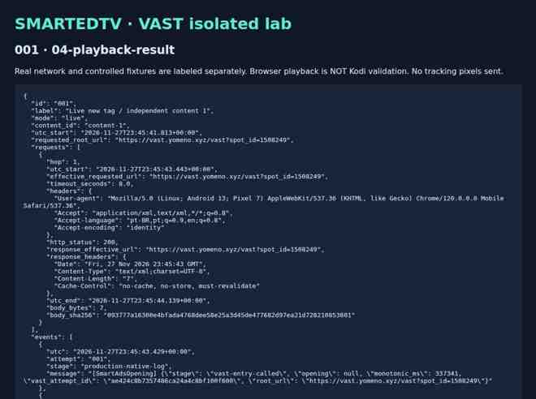
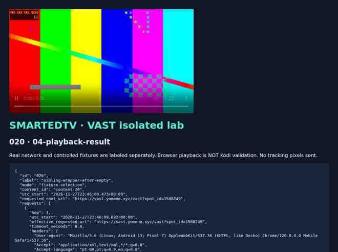

# Recuperação VAST e fluxo inicial — build 46084100325

## Entrega

- **APK novo, teste físico:** [SMARTEDTV-universal.apk](https://github.com/edinhoms97-creator/SMARTED/releases/download/smarted-recovery-46084100325-1/SMARTEDTV-universal.apk).
- [Release e auditorias](https://github.com/edinhoms97-creator/SMARTED/releases/tag/smarted-recovery-46084100325-1).
- [Execução de construção e comparação — sucesso](https://github.com/edinhoms97-creator/SMARTED/actions/runs/46084100325).
- Fonte exata: `5347666267a0bb7be6423ead5f24313ba076d048`, branch `arena/16384c6f-smarted`.
- SHA-256: `6510b917a159e2b8ab216289ada2e4b2015aa4b29fa81809caa120fc7fe8f0a2`.
- Tamanho: **263.230.975 bytes**. Mesmo tamanho do anterior, **conteúdo e hash diferentes**, reconstruído e assinado. Não é o APK antigo renomeado.
- Identificador desta entrega é o run/release acima; Manifest/versionCode não foram alterados para respeitar a preservação estrita.
- Universal ARM32 + ARM64, alinhamento de 16 KB verificado, certificado igual ao APK-base. A assinatura de teste não prova posse de chave oficial.
- Nenhum merge; Dropbox oficial não substituído.

## Histórico identificado por conteúdo, não pela data

O build **45992589750**, fonte `6b45630`, possui skin original corrigida e `INTERVALO=120` dentro de `ads_regra.py`. SHA-256 do APK: `f6ecfb6059bd1afbfadb9bd81065f45887781c1223e2d85b3bf19f748c7f44c6`. O build anterior retirado por skin incorreta não foi usado como base.

A comparação real do histórico com o atual anterior **46079704676** preservou 8.049 entradas ZIP e encontrou cinco módulos de anúncios diferentes; skin, inicialização, Manifest e bibliotecas nativas eram iguais. O histórico é uma referência de implementação válida, **não prova de alto fill histórico ou reprodução física frequente**: não foi localizado registro suficiente para afirmar isso.

O APK-base desta entrega é exclusivamente o atual 46079704676, SHA-256 `919e97db0929ab90f189c9503722f4a5139feda573a28c96d79973a8e70e6087`. Não houve restauração integral de pacote histórico, regra de 120s ou player antigo.

## Timeouts: escopo exato e decisão

A leitura foi feita nos dois APKs reais antes da escolha do orçamento. Resultado completo: `evidence/history-recovery/timeout-limits-before.json`.

| Limite | Histórico real | Atual anterior | Atual posterior |
|---|---|---|---|
| HTTP XML, por chamada em `baixar` | até 8s | até 8s, reduzido pelo saldo global | até 8s, reduzido somente pelo saldo do novo teto |
| Cadeia inteira em `exibir` | sem deadline agregado | **8s compartilhados por todos os hops** | **24s compartilhados**, derivados de 8s × (profundidade 2 + raiz) |
| Watchdog de travamento do anúncio | constante 6s | constante 6s | inalterado |
| Áudio sem quadro | constante 2,5s | constante 2,5s | inalterado |
| Limite máximo de reprodução | constante 45s | constante 45s | inalterado |
| `FOLGA_FIM` | 1,5s | 1,5s | inalterado |
| Confirmação de seek | 3s no histórico | subdeadline de até 3s na restauração atual | inalterado |

**A configuração de player “3s / duração + 5s” está em outro perfil de código do repositório; não é o player embalado no APK-base publicado.** Nenhum valor do player, nem qualquer configuração 3s/5s existente no payload atual, foi trocado. `reproduzir`, `restaurar`, helpers, callbacks e controles permaneceram byte a byte iguais ao APK-base. O relatório evita confundir configuração histórica de fonte com execução do APK entregue.

### Prova com HTTP realmente atrasado

Servidor HTTP local introduziu **3s por hop**, XML idêntico e downloader real de cada APK. Apenas o destino de rede foi roteado ao servidor local e o player substituído por captura de seleção. Relógio e timeouts de socket reais; não é tráfego do provedor nem reprodução nativa.

| APK | HTTP enviados | Timeouts efetivamente repassados | Tempo observado | Criativo selecionado |
|---|---:|---|---:|---|
| Histórico | 3 | 8 / 8 / 8s | 9,046s | sim |
| Atual anterior | 3 | ~8 / 4,985 / 1,970s | 8,021s | **não** |
| Atual posterior | 3 | 8 / 8 / 8s | 9,045s | **sim** |

Logo, o limite global de 8s cortava uma cadeia XML válida antes de chegar ao player. O orçamento recuperado mantém o limite histórico por requisição e adiciona um teto finito para toda a travessia, inclusive alternativas. Não é pausa, espera fixa, retry de raiz ou intervalo entre anúncios. Retorna imediatamente quando há seleção, vazio ou falha terminal.

Replay adicional com relógio virtual: cadeias de 0,3 e 6s selecionadas nas três versões; cadeias de 9 e 12s selecionadas no histórico e no posterior, rejeitadas no anterior. Cada tentativa fez exatamente uma consulta raiz. Os JSONs distinguem explicitamente relógio virtual de HTTP real.

## Consultas consecutivas e resultados sem misturar fixtures

Raiz usada nas três versões: `https://vast.yomeno.xyz/vast?spot_id=1508249`. O histórico foi chamado com a nova raiz para comparação controlada; seu valor antigo não foi restaurado nem usado como fallback.

| Medida | Histórico | Atual anterior | Atual posterior |
|---|---:|---:|---:|
| Consultas raiz novas ao provedor | 3 | 3 | 3 |
| Respostas HTTP reais | 3 | 3 | 3 |
| Respostas vazias do provedor | 3 | 3 | 3 |
| Criativos reais selecionados | 0 | 0 | 0 |
| Anúncios reais tocados em Kodi/aparelho | 0 | 0 | 0 |
| Cenários controlados adicionais | 33 | 33 | 33 |
| Seleções nos cenários controlados | 18 | 26 | 26 |
| Sem seleção nos cenários controlados | 15 | 7 | 7 |
| Reproduções de padrão local no browser | 18 | 26 | 26 |

As 33 fixtures não são todas casos positivos. No anterior/posterior, as sete sem seleção são: dois VAST vazios, duas falhas de rede, dois sem mídia compatível e um VMAP sem preroll. No histórico, os motivos agregados são treze `vast-sem-criativo` e dois `tag-sem-resposta`; não interpretar todos como no-fill legítimo: há fixtures válidas que o seletor antigo não recupera.

Nos três GETs posteriores: HTTP 200, corpo de sete bytes, hash `093777a16300e4bfada4768dee58e25a3d45de477682d97ea21d728210853801`, classificado como VAST vazio. São tentativas independentes; não houve cache de vazio, reutilização de criativo, pixel artificial ou retry para fabricar fill. As consultas anteriores ocorreram aproximadamente 23:29/23:30 UTC e as posteriores 23:45 UTC em 27/11/2026; não são amostras simultâneas nem demonstram disponibilidade futura.

O posterior preservou o desempenho do seletor atual nas mesmas fixtures: recuperação de irmãos Wrapper/VMAP, resolução de URLs relativas e pareamento MediaFile/duração/ID. Seleção e vídeo de teste no browser **não equivalem a anúncio real tocado no Kodi**.

## Inicialização: defeito nativo observado e correção restrita

A prova anterior veio do APK atual exato instalado no emulador Android, sem alterar ABI/perfil:

1. `23:39:28.864`: vigia declara tela ausente após 8s e manda abrir Home.
2. `23:39:30.491`: Home ativa.
3. `23:39:31.803`: diálogo registra tela de entrada carregada.

Isso comprova uma corrida: a Home foi antecipada antes do desenho tardio do diálogo. Registro completo em `evidence/history-recovery/android-before.json`.

Foram alteradas somente duas funções existentes de `script.smartedtv.welcome/default.py`:

- `abrir_tela_entrada`: remove os dois retornos diretos à Home por ativação/reentrada; o diálogo existente volta a ser chamado. A lógica de validação VIP não é alterada.
- `vigiar_inicializacao`: ao esgotar a observação inicial sem marcas de diálogo, deixa de mandar abrir a Home. Não aumenta prazo, não reinicia app e não cria novo vigia. O dispatcher existente conserva seu tratamento de erro e fallback quando não consegue construir/exibir o diálogo.

Doubles de ordenação passaram nas quatro combinações ativado/reentrada; teste adicional reproduz o atraso do desenho e verifica que o observador posterior não antecipa a Home. Isso não prova warm task ou reprodução física.

A primeira tentativa de publicação (46083811436) foi cancelada ao chegar essa evidência nativa, antes de anexar APK. A seguinte (46084011903) falhou no gate de correspondência textual do código e também não publicou APK. A entrega válida é **somente 46084100325**, que passou após tornar o reconhecimento AST estrito, sem depender de espaços em branco.

### Resultado Android posterior — execução real, não aprovação de ciclos

[Run Android 46084408518](https://github.com/edinhoms97-creator/SMARTED/actions/runs/46084408518), job 140790495321. APK instalado com sucesso no Android 11 em AVD x86_64 com tradução ARM; ABI do APK não foi alterada. SHA-256 do APK instalado igual ao publicado; hashes dos cinco módulos de anúncios em runtime conferem com o APK.

Às `23:51:22.469 UTC`, o log registra **tela de entrada carregada (antes da Home)**. Não aparece a antecipação da Home pelo vigia nessa sequência. A captura real abaixo mostra a tela original, não um mock ou browser:

**Limitação importante:** o harness não conseguiu prosseguir pela escolha gratuita (`original-welcome-not-ready-for-free-choice`; `welcome_ready_observed=false`). Os três ciclos de conteúdo constam como **not-run**, não zero-fill, e não houve download de amostra nem reprodução nativa validada. A captura e o log comprovam a exibição da entrada nesse boot, não a sequência completa entrada→inicialização→Home nem reabertura em warm task. O run verde significa execução/registro do teste, não aprovação desses critérios funcionais. JSON integral em `evidence/history-recovery/android-after.json`.

## Auditoria e testes

O APK assinado final tem somente estas entradas de produção diferentes do APK-base:

1. `assets/addons/service.smarted.bootstrap/ads_vast.py`: somente `exibir`, orçamento da consulta.
2. `assets/addons/script.smartedtv.welcome/default.py`: somente `abrir_tela_entrada` e `vigiar_inicializacao`, fluxo inicial descrito acima.

**8.052 entradas preservadas.** Nenhum byte fora dessas três funções foi modificado no payload. Assinaturas do contêiner foram regeneradas normalmente. Skin/layout/Home/categorias/addons, Manifest, bibliotecas, AdMob, VIP, tracking geral, player e retomada iguais ao APK-base. A função de verificação de licença continua intacta; somente seu uso como atalho inicial foi retirado.

`INTERVALO=0` auditado no APK-base; módulo de regra preservado. Teste de novos conteúdos consecutivos com um segundo de diferença não os bloqueia. Não há cooldown, teto por sessão ou bloqueio pelo anúncio anterior introduzidos. Callback duplicado/pausa/seek/reconexão/retorno de anúncio seguem a mesma elegibilidade atual, sem alteração de `ads_openings.py` ou `ads_regra.py`.

Verificação canônica `npm run verify` passou localmente e no job; testes de função VAST (19), testes de startup/sem cooldown (7, com constante do APK verificada no CI), testes do payload completo e comparações HTTP/virtual também passaram no job publicado. Skips locais que dependem do APK são identificados como tal; não são aprovação física.

## Evidências independentes e teste físico

[Arquivo completo de evidências](https://github.com/edinhoms97-creator/SMARTED/releases/download/smarted-recovery-46084100325-1/history-recovery-evidence.zip): **212.286.740 bytes**, SHA-256 `e88c612fc84cad1575901af6e9cf97f0342e6a442e3dcedd7f1bc3621c3eb5ea`.

Contém histórico/anterior/posterior, índices HTML, quatro capturas por tentativa, respostas XML sanitizadas, JSON, logs, diffs das três funções e auditorias. Pasta `comparison-before` separada de `after`; `budget-before` e `audit/*budget*` explicitamente marcados como transporte local/relógio controlado.

Prévia de consulta real vazia posterior:

Prévia de seleção em fixture de recuperação de irmão (vídeo local de teste, não anúncio real):

### Roteiro no aparelho

1. Instalar o APK novo sobre a versão compatível; confirmar backup antes de qualquer desinstalação. Validar assinatura conforme necessidade do aparelho.
2. Abrir a frio: tela original deve aparecer antes da Home; prosseguir pelo fluxo existente. Repetir com licença/reentrada, sem mudar validação.
3. Sair normalmente e abrir novamente; testar também retorno pelo ícone/tarefa. Registrar vídeo e horários.
4. Abrir conteúdos novos A/B/C sem esperar 120s; verificar uma consulta nova por abertura elegível. Pausar/seek/reconectar/retornar do anúncio não devem criar outra abertura.
5. Se houver criativo real, verificar início/quartis/conclusão, liberação, conteúdo retomado e controles. Se resposta vier vazia, registrar XML/status sem inventar falha do player.
6. Correlacionar logs do aparelho com eventos reais do painel; não usar fixtures para contabilização.

**Pendente:** reprodução real de anúncio em aparelho físico, warm task em dispositivos-alvo e confirmação no painel. Não se promete fill do provedor nem aprovação final a partir deste laboratório.
