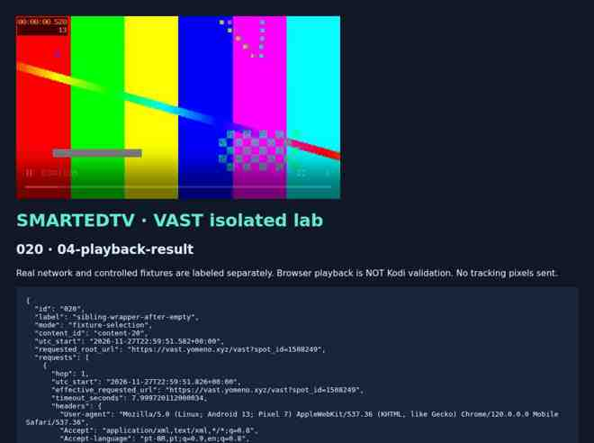
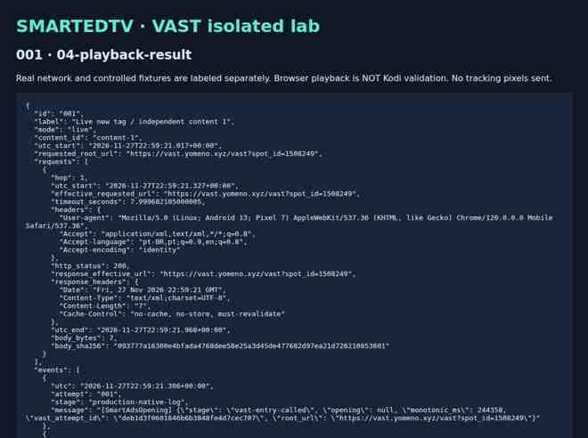

# VAST 1508249 — correção de seleção, somente `ads_vast.exibir()`

## APK liberado para teste físico

**[Baixar SMARTEDTV-universal.apk](https://github.com/edinhoms97-creator/SMARTED/releases/download/smarted-vast-only-46079704676-1/SMARTEDTV-universal.apk)**

- Build: [46079704676 — concluído com sucesso](https://github.com/edinhoms97-creator/SMARTED/actions/runs/46079704676).
- Fonte do APK: `9329fbabbcdf6c690285623ea7733c4f9303b5d8`.
- SHA-256: **`919e97db0929ab90f189c9503722f4a5139feda573a28c96d79973a8e70e6087`**.
- Tamanho: **263.230.975 bytes**, ARM32+ARM64. Novo payload/hash; não é APK antigo renomeado.
- Tag efetiva fixa: **`https://vast.yomeno.xyz/vast?spot_id=1508249`**, sem fallback automático antigo.
- Base exata: APK 46074593488, SHA-256 `2b64c443f42902cb07031db1106137a59d852ae39bb8fbd8b9379b8a6d2682bc`.
- Única entrada de código alterada contra essa base: `assets/addons/service.smarted.bootstrap/ads_vast.py`; **8.053 outras entradas não-assinatura preservadas**.
- Dentro de `ads_vast.py`, **apenas `exibir()`**. Comparação de bytes anteriores/posteriores e AST das demais definições/constantes passou.
- Apksigner/zipalign passaram; certificado conferido contra o APK-base. Assinatura de teste preservada, não prova de chave oficial. Fazer backup antes de qualquer desinstalação.

**Limite da conclusão:** descartes específicos foram reproduzidos e corrigidos. A matriz passou, mas isso não é garantia universal de todas as variantes VAST, de decodificação de todo MediaFile nem de reprodução física Android. O APK está liberado justamente para esse teste. Não se atribui todo o problema relatado a inventário vazio.

O candidato 46078577850 era intermediário, com diagnóstico e tag apenas; **o APK indicado agora é 46079704676**, que contém a correção de seleção solicitada na etapa adicional. `VAST_REGRESSION_RELEASE.md` descreve uma entrega histórica, não esta.

## Defeitos reproduzidos antes do novo patch

Laboratório isolado criado no commit `a977e9b`, antes de alterações de produção desta missão. A expansão da matriz foi executada em [46079223776](https://github.com/edinhoms97-creator/SMARTED/actions/runs/46079223776) **antes da correção do seletor**; o build final repetiu a matriz antes/depois sobre a base exata e o APK novo.

### 1. Encerramento no primeiro ramo, ignorando alternativas válidas

Fluxo anterior:

```
escolher_anuncio(data) não seleciona mídia
  -> tag_do_wrapper(data) or tag_do_vmap(data) retorna apenas o primeiro destino
  -> substitui data pelo resultado desse destino
  -> vazio / XML inválido / ciclo: retorna imediatamente
```

A lista original de `Ad`/Wrappers/fontes VMAP era perdida. Uma resposta podia conter outro ramo com criativo válido e, mesmo assim, ser encerrada como sem anúncio.

**Evidência 020:** raiz com dois Wrappers; primeiro destino `<VAST/>`, segundo destino com MP4 válido. Antes: dois GETs e retorno sem mídia. Depois: três GETs (raiz, primeiro destino, segundo destino), `creative-selected`, mídia encaminhada ao adaptador do laboratório e avanço do vídeo de teste. Não houve nova consulta à raiz para tentar obter fill.

Os casos 021/022 reproduzem o mesmo problema após XML inválido/ciclo. O caso 023 demonstra alternativa de pré-roll VMAP após a primeira responder vazia.

### 2. Mídia e duração/ID de criativos diferentes

`escolher_anuncio()` usava o primeiro `Linear` para duração/eventos e `_media_escolhido(inline)` procurava mídia no `InLine` inteiro. Com dois criativos, podia selecionar o MediaFile do segundo e atribuir metadados do primeiro.

**Evidência 024:** antes, MP4 do criativo `chosen` com duração **29s** e ID **`wrong`**; depois, a mesma mídia com duração **5s**, ID **`chosen`** e eventos do Linear correto. Player não foi modificado para compensar metadados errados.

### 3. XML/destinos válidos não reconhecidos

A matriz também reproduziu falhas com `VASTAdTagURL` legado, URL relativa de Wrapper, namespace declarado com aspas simples, MediaFile com URL iniciada por `//` e VAST embutido como texto CDATA no VMAP.

A normalização/travessia dessas formas foi acrescentada **dentro de `exibir()`**, sem modificar `sem_namespace`, `tag_do_wrapper`, `tag_do_vmap`, `escolher_anuncio` ou `_media_escolhido` compartilhados.

### 4. VMAP de mid-roll não é pré-roll

A base podia selecionar o anúncio embutido de um intervalo `00:10:00` durante uma abertura. Esta entrada de pré-roll agora considera os intervalos iniciais, sem antecipar mid/post-roll. Esse caso retorna `vmap-sem-preroll`, não é tratado como inventário global vazio. Não foi criado um agendador de mid-roll.

## Correção efetiva — uma função em produção

Fonte revisável: [`android-build/vast-function-only/ads_vast.py`](../android-build/vast-function-only/ads_vast.py). O patcher aplica somente essa função sobre o APK-base e rejeita qualquer byte diferente fora dela.

- Uma raiz nova por invocação, sempre tag 1508249. `vast_attempt_id` novo nos logs e recibo; UUID não é enviado como parâmetro da tag ou pixel.
- Percorre alternativas **declaradas na resposta** em ordem; falha de um ramo não encerra os ramos irmãos ainda possíveis.
- Trata VAST 3.0, namespaces/CDATA, Wrapper simples/encadeado, VAST embutido e URI externa de pré-roll VMAP, `VASTAdTagURI`/`VASTAdTagURL`, URLs relativas/protocolo relativo.
- Para cada `Linear`, chama o **seletor nativo inalterado** com somente aquele criativo. MediaFile, duração, ID, skip e eventos ficam associados ao mesmo Linear.
- Herança de Impression/Error/Tracking é montada pelo caminho selecionado; ramo descartado não doa impressão ao criativo escolhido. Os testes conferem isso. Funções de tracking, macros, UA e envio não foram modificados; o laboratório não envia pixels.
- A política nativa MP4/WebM/HLS permanece; nenhum filtro novo de codec, resolução, bitrate ou duplicidade de criativo foi adicionado. Um criativo repetido continua elegível se retornado novamente.
- XML realmente vazio termina sem interromper o conteúdo. Mídia não aceita recebe `sem-midia-compativel`; não se promete MediaFile onde o XML não contém um.
- Mantidos orçamento total **8s**, limite nativo de profundidade Wrapper, proteção de ciclo e fail-open. Timeout/limite/ciclo não são confundidos com inventário vazio. Não foram adicionadas tentativas artificiais à raiz nem delays.

Por escopo literal, constantes históricas e `tag_configurada()` permanecem byte-idênticas à base. O texto de uma tag antiga pode ainda existir no APK, mas **não é raiz efetiva nem fallback de `exibir()`**; teste com argumento antigo/vazio exige exclusivamente a raiz nova.

## Matriz visual — resultado final

**27 cenários dirigidos; 11 divergências antes, zero depois.** São nove falhas de recuperação/normalização, um pareamento incorreto e uma seleção indevida de mid-roll. Não são 11 anúncios reais do provedor.

| IDs | Cenário | Depois |
|---|---|---|
| 010–013 | VAST 3.0, namespace, MediaFile válido após inválido, outro Ad válido | Mídia selecionada |
| 014–016 | Wrapper, cadeia de Wrappers, VASTAdTagURL legado | Mídia selecionada |
| 017–019 | VMAP URI externa, VASTAdData embutido, VMAP → Wrapper → VAST | Mídia selecionada |
| 020–022 | Ramo irmão após vazio, XML inválido ou ciclo | Segundo ramo selecionado |
| 023 | Outra fonte de pré-roll VMAP após vazio | Mídia selecionada |
| 024 | Duração/ID do mesmo criativo do MediaFile | 5s / `chosen`, sem metadados do primeiro |
| 025–028 | URL relativa, namespace com aspas simples, `//` no MediaFile, MediaFile vazio antes de válido | Mídia selecionada |
| 029–031 | WebM/HLS e ausência de novo filtro de codec/resolução | Política de seleção nativa mantida |
| 032 | VAST em CDATA no VMAP | Mídia selecionada |
| 033 | Intervalo somente de mid-roll | Não antecipado como pré-roll |
| 034–036 | VAST vazio, NonLinear, formato não aceito | Não inventa anúncio |

As fixtures válidas usam um **padrão de vídeo local MP4**, identificado como fixture. A seleção de uma URL WebM/HLS na matriz comprova encaminhamento/política do seletor, **não decodificação real desse formato**; o padrão local do browser não substitui esse teste. O navegador registra avanço inicial, não conclusão Kodi.

### Chamadas independentes / vazio anterior

| Caso final | Fonte | Resultado |
|---|---|---|
| 001 — primeira chamada | Rede real | HTTP 200, 7 bytes, `<VAST/>`, sem Ad/MediaFile |
| 002 — segunda chamada | Rede real | Novo GET/ID; HTTP 200, 7 bytes, `<VAST/>` |
| 003 — terceira chamada | Rede real | Novo GET/ID; HTTP 200, 7 bytes, `<VAST/>` |
| 004/005 — conteúdos A/B | Fixtures válidas | GETs e seleções próprios; vídeo de teste avançou |
| 006 — vazio | Fixture | Fail-open sem mídia/player/impressão |
| 007/008 — conexão/timeout | Fixtures | Erros de transporte registrados; sem cache de falha |
| 009 — após 006–008, mesmo processo | Fixture válida | Novo GET, seleção e avanço de 0,2062s no browser |

As três respostas reais finais foram obtidas em **2026-11-27, aproximadamente 22:59 UTC**, no runner GitHub, não no IP do celular. SHA-256 bruto de cada XML vazio: `093777a16300e4bfada4768dee58e25a3d45de477682d97ea21d728210853801`.

Isso comprova respostas vazias **nessas consultas**, não ausência global de inventário nem causa única da regressão do aparelho. HTTP200 não foi contado como anúncio reproduzido. Baseline real anterior 46078100066 e rodada intermediária 46078577850 também estão preservados como históricos.

**Confirmação com limite explícito:** cada invocação da função realiza nova consulta; não existe reaproveitamento de XML vazio entre invocações. Os testes de ciclo exercitam elegibilidade com doubles, mas três aberturas reais do catálogo/monitor no telefone ainda precisam de validação física. Chamar diretamente `exibir()` no laboratório não prova que um gate externo autorizou a abertura.

## Gates externos — evidência separada, nenhuma alteração

Ver [VAST_EXTERNAL_GATES_1508249.md](VAST_EXTERNAL_GATES_1508249.md). Ele identifica condições de `_talvez_mostrar`, `Opening.claim` e observação nativa que podem impedir a chamada antes de VAST. Não houve evidência física suficiente para atribuir a regressão atual a uma delas. Foram apenas lidas; não foram relaxadas/modificadas.

Player, tracking, AdMob, VIP, monitor, Home, retomada, navegação, welcome e outras funções de anúncios permanecem exatamente como na base desta missão. Nenhum merge ou substituição do Dropbox oficial.

## Testes executados

- `npm run verify`: passou localmente e no runner. Casos locais que exigem APK completo são explicitamente skipped, não foram contados como executados.
- **19 testes de função**, incluindo matriz de 27 cenários, contra a função candidata e os helpers do APK exato no runner. Cobrem IDs únicos, ausência de fallback/cache, repetição de criativo, herança do ramo selecionado, limite de profundidade e prazo que não reinicia entre irmãos.
- **33 regressões de ciclo**, incluindo importação/casos de módulos completos extraídos do **novo APK**. São doubles das APIs Kodi; não se anunciam como 33 reproduções Android. Incluem completion único, tracking mantido, pause/seek/reconexão sem nova oportunidade, Stop/Home/nova seleção e VIP.
- Laboratório visual antes/depois: **36 tentativas por rodada**; três chamadas reais somente na rodada final, demais casos claramente identificados como fixtures. Baseline imediatamente anterior ao patch usou fixtures, sem repetir rede real.
- Auditoria ZIP/AST/bytes, assinatura contra a base, ARM32+ARM64 e zipalign: passaram.
- Reprodução física Android, áudio/controles/retorno com anúncio real e contagem no painel: **pendentes**. O teste Android histórico bloqueado no welcome não valida este APK e não foi usado como aprovação.

## Prints e logs, leitura independente sem reexecução

**[Baixar pacote completo de evidências — 202,9 MB](https://github.com/edinhoms97-creator/SMARTED/releases/download/smarted-vast-only-46079704676-1/VAST-1508249-evidence.zip)**

- SHA-256 do ZIP: `be23dc3a36081d6a1f80ca502e7fae80b18c68295370d3ab542adcb14676b49e`.
- Publicado como asset da prerelease, não depende da retenção de 30 dias do artefato Actions.
- `baseline/evidence/index.html` e `after/evidence/index.html`: abrir offline; pastas 001–036 com **quatro screenshots PNG reais por etapa**, JSON/JSONL e XML completo sanitizado. Os PNGs de página inteira são maiores e mais legíveis que os previews abaixo.
- `previous-live` preserva o laboratório inicial anterior às alterações; `selection-before` preserva a matriz que reproduziu os defeitos antes da correção.
- Logs incluem `vast-entry-called`, request/resposta, rejeição de ramo, seleção, recibo, MediaFile e resultado browser, com horários e IDs. URLs de query sensíveis são ocultadas; hash bruto é mantido.
- Pasta `audit`: diff exato da função, relatórios de preservação, certificado/badging e instruções. [Diff também disponível separadamente](https://github.com/edinhoms97-creator/SMARTED/releases/download/smarted-vast-only-46079704676-1/exibir.diff).
- Pasta versionada [evidence/vast-function-1508249](evidence/vast-function-1508249): `selection-final-before.json`, `selection-final-after.json`, auditorias e previews. Permite comparar os 27 cenários sem baixar todos os PNGs ou executar código.

### Print real: seleção após primeiro ramo vazio (fixture, não anúncio real)



### Print real: resposta vazia da chamada live



## Próximo teste: aparelho físico

Instalar o APK **46079704676** e abrir três conteúdos elegíveis, uma vez cada. Para cada abertura, procurar no `kodi.log` somente as linhas `[SmartAdsOpening]` relevantes:

`opening-claimed` → `vast-entry-called`/ID → `vast-request` → resposta → `creative-selected` ou motivo final.

Com anúncio real: observar início/avanço, conclusão única, tracking e retorno ao conteúdo. Sem `vast-entry-called`, a interrupção ocorreu antes da função; preservar o motivo de `attempt-blocked` e não culpar inventário. Com XML vazio, liberar conteúdo; não solicitar automaticamente a mesma raiz até obter fill. Pausa, seek, reconexão e callbacks duplicados não são novas aberturas.

Não enviar o log inteiro sem revisão: outras linhas podem conter URLs/dados de provedores. AdMob permanece adiado, sem reativação nesta entrega.
